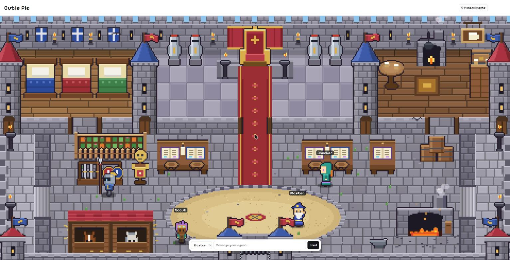

# Cutie Pie

A pixel-art castle where your AI agents live. You give a task to **Master**, he takes the throne, picks the best agent for the job, briefs them, and the agent walks to a desk, does the work, and comes back to report. Each agent runs on **Claude Code** or on **opencode** (which has free models), and you choose per agent.



- **Chat** with any agent from the bar at the bottom, or click a character in the castle.
- **Master hands work over** and shows why he chose each agent.
- **Manage Agents**: create agents with a role, a provider, a model, a thinking level, and the tools each one may use.
- **Runs on your computer.** There is no server to rent and no account to create with Cutie Pie.

> Each person installs their **own copy** and signs in with **their own** account. Please don't share one running copy: it would give other people control of your computer and your login. See [Safety](#safety).

---

## What you need

| | |
|---|---|
| **Node.js 20 or newer** | Get it from <https://nodejs.org>. Check with `node -v`. |
| **A browser and internet** | The castle engine (Phaser) and the font load from a CDN. |
| **At least one agent runner** | **Claude Code** (needs a Claude Pro, Max, Team, Enterprise or Console account) **or** **opencode** (its free models need no account). You can install both. |

There is nothing to `npm install` for Cutie Pie itself.

## Install and run

```sh
git clone https://github.com/kyiwsr/cutie-pie.git
cd cutie-pie
```

Then start it:

- **Windows:** double-click `start.bat`
- **macOS / Linux:** run `./start.sh`
- **Any system:** `npm start` or `node server.mjs`, then open <http://127.0.0.1:4530>

On the first start Cutie Pie creates `agents.json` (a starter team: Master, Scout, Builder, Checker) and a `workspace` folder where the agents work.

## Choose how the agents run

### Option A: Claude Code

1. Install Claude Code, with the commands from Anthropic's [setup page](https://code.claude.com/docs/en/setup):
   - macOS, Linux, WSL: `curl -fsSL https://claude.ai/install.sh | bash`
   - Windows PowerShell: `irm https://claude.ai/install.ps1 | iex`
   - Homebrew: `brew install --cask claude-code` · WinGet: `winget install Anthropic.ClaudeCode`
2. Open a **new** terminal and check it with `claude --version`.
3. Start Cutie Pie. If you are not signed in, a login page appears: click **Log in with Claude**. Anthropic's own sign-in page opens in your browser, and Cutie Pie carries on by itself when you finish. Cutie Pie never sees your password.

On Windows, use the native installer or WinGet above. Cutie Pie starts `claude` directly.

### Option B: opencode (free models)

1. Install opencode 2 or newer: `npm install -g opencode-ai@latest` (other methods are on <https://opencode.ai/v2/docs>).
2. Restart Cutie Pie.
3. On the login page, click **Continue without Claude (use opencode)**. If Claude Code is not installed, that is the only option shown.
4. Open **Manage Agents**. If the first start happened without Claude, the starter team is already set to a free model. Otherwise open each agent, choose **Provider: opencode** and pick a model under **Free, no account needed**.

Free models are offered by opencode, and they can change or have limits at any time. See opencode's own terms.

### Both

Set each agent's **Provider** in Manage Agents. A team can mix them: for example Master on Claude and the workers on opencode.

## Using it

- **Talk to an agent:** type in the bar at the bottom, choose the agent from the dropdown, or click a character. The chat opens on the left, and the **×** puts it back at the bottom.
- **Give Master a task:** he says he understood, takes the throne and explains who he picked and why. That agent is briefed at the throne, walks to their desk to work, then returns to report. Master stays on the throne until the results are in and he has told you the outcome.
- **Manage Agents** (top bar): add, edit or delete agents (up to 10, one character each). Pick a ready-made role or write your own, choose the provider, model and thinking level, and tick the tools the agent may use.
- **Log out** (top bar, red): signs Claude Code out, or, when you are working without Claude, takes you back to the login page.
- **The strip in the middle** shows connected tools (MCP servers) as icons.

Master chooses by reading each agent's role, so a clear role steers who gets the work.

## Safety

Read this before you use it.

- **Agents act on your computer.** Each message starts `claude` or `opencode` on your machine, so an agent can do what its tools allow:
  - **Read, Glob, Grep** read files. An agent with **Read** can read files **anywhere** on your computer, not only in its folder.
  - **Edit, Write** change files. **Bash** runs commands. Only tick these for agents you trust with that.
- **Agents work in the `workspace` folder by default.** To point them at one of your projects, set `WORKDIR` before starting:
  - macOS / Linux: `WORKDIR=/path/to/project ./start.sh`
  - Windows PowerShell: `$env:WORKDIR="C:\path\to\project"; node server.mjs --open`
  - Windows CMD: `set WORKDIR=C:\path\to\project && node server.mjs --open`
- **It only listens on your own computer (`127.0.0.1`).** Don't expose it with a tunnel or by changing that. Anyone who could reach it could use your agents, and through them your files and your login.
- **Don't share your login.** Anthropic's terms don't allow routing other people through your Claude login, so every person should install their own copy and sign in with their own account.
- **Your prompts and files go to the provider you choose** (Anthropic for Claude, or the model provider behind opencode).

## Settings

| Variable | What it does | Default |
|---|---|---|
| `PORT` | Port to listen on | `4530` |
| `WORKDIR` | Folder the agents work in | `workspace` next to the app |
| `OPENCODE_BIN` | Full path to the opencode program, if it is not found | auto |

Your team lives in `agents.json`, which you can also edit by hand. To start over, delete it and restart: a fresh starter team is created.

### Connector icons

The strip shows each connected tool by name. To show a logo instead, put a square PNG named after the tool in `logos/` (for example `gmail.png`). Cutie Pie doesn't ship brand logos.

## Troubleshooting

| What you see | What to do |
|---|---|
| "Claude Code is not installed" | Install it (Option A), or use opencode (Option B). |
| The login page says to sign in but no window opens | Use the "Open the sign-in page" link, or run `claude auth login` in a terminal. |
| "opencode is not installed" in Manage Agents | `npm install -g opencode-ai@latest`, then restart Cutie Pie. If it is installed somewhere unusual, set `OPENCODE_BIN`. |
| "This needs opencode 2" in chat or Manage Agents | You have opencode 1.x. Upgrade with `npm install -g opencode-ai@latest` or `curl -fsSL https://opencode.ai/install \| bash` (other methods are on <https://opencode.ai/v2/docs>), then restart Cutie Pie. |
| The usage gauge says "unavailable" | It reads your Claude plan's usage, which Anthropic rate-limits, and it may not be available on every system (macOS keeps the Claude login in the Keychain). It is cosmetic. |
| A blank page where the castle should be | The castle engine loads from the internet. Check your connection. |
| "Address already in use" | Another copy is running. Close it, or start with `PORT=4531`. |
| Chats say a tool is not allowed | The agent tried a tool that isn't ticked. Open Manage Agents, then **Check allowed tools**. |

## How it works

`server.mjs` is a small Node server with no dependencies. For each message it starts the agent's runner (`claude -p`, or `opencode run`) with the agent's role as the system prompt and its tools as the permission list, and streams the answer to the page. Master hands work over with a short `<delegate>` block in his reply; the page reads it, runs the chosen agent and sends the result back to Master. The castle is a Phaser scene drawn entirely in code (`src/`, built into `office.js` by `node build.mjs`).

| File | Purpose |
|---|---|
| `server.mjs` | The server: agents, chat, sign-in, connectors |
| `auth.mjs`, `usage.mjs`, `mcp.mjs`, `opencode.mjs` | Sign-in, plan usage, connector list, opencode support |
| `index.html`, `topbar.js`, `chat.js`, `auth.js` | The page |
| `src/`, `build.mjs`, `office.js` | The castle scene and its build |
| `agents.example.json`, `agents.opencode.json` | Starter teams |

If you change something in `src/`, run `node build.mjs` to rebuild `office.js`.

## Credits and terms

The castle, characters and effects are original pixel art drawn in code. The scene runs on [Phaser](https://phaser.io) (MIT).

Claude Code and opencode are separate products with their own terms. Cutie Pie only starts them on your computer, using your own account.

Cutie Pie itself is released under the [MIT License](LICENSE).
